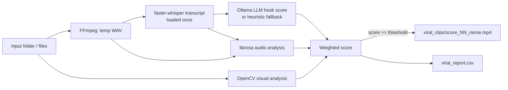

# Viral Clip Detector (100% Free, Offline)

Scans a folder of video clips, scores each one **0-100** for viral potential, and copies the winners into `viral_clips/` as `score_88_clip_04.mp4`. No paid APIs, no cloud, no API keys.

Two ways to use it:

| Mode | Command |
|------|---------|
| **Desktop UI** (pick input/output with buttons) | `python viral_clip_gui.py` |
| **Command line** | `python viral_clip_detector.py --input ./clips` |

## How it scores



```
Final_Score = round(0.40 * Text_Hook + 0.35 * Audio_Energy + 0.25 * Visual_Motion)
```

* **Audio Energy (35%)** - RMS loudness, loudness spikes/min, silence ratio, energy variance, tempo, and words-per-minute.
* **Text Hook (40%)** - transcript + first 5 seconds. Local Ollama rates hook strength, emotional punch and curiosity gap (1-10, scaled to 100). If Ollama is missing, a heuristic scores power words, questions, numbers, fast start, punchy sentences and pace.
* **Visual Dynamics (25%)** - frames sampled every 0.5 s: motion, scene cuts, face presence and close-ups (Haar cascade).

## Quick start (all platforms)

```bash
python -m venv .venv
# activate it (see OS sections below), then:
pip install -r requirements.txt
python viral_clip_gui.py
```

The first run downloads the Whisper model once (needs internet one time); after that everything is offline.

---

## Windows

1. **Python 3.10+**: `winget install Python.Python.3.12` (tick *Add to PATH* if you use the installer from python.org). Tkinter is included.
2. **FFmpeg**: `winget install Gyan.FFmpeg`, then **close and reopen** your terminal. Check with `ffmpeg -version`. If not found, add the FFmpeg `bin` folder to *System Properties > Environment Variables > Path*.
3. **Virtual environment**
   ```powershell
   cd path\to\project
   python -m venv .venv
   .venv\Scripts\activate
   pip install -r requirements.txt
   ```
   If activation is blocked: `Set-ExecutionPolicy -Scope CurrentUser RemoteSigned`.
4. **Ollama (optional)**: `winget install Ollama.Ollama`, then `ollama pull qwen2.5:3b`. NVIDIA GPUs are used automatically.
5. **NVIDIA GPU for Whisper (optional)**: install the latest NVIDIA driver; if CUDA errors appear, the app falls back to CPU automatically.

## macOS (Apple Silicon M1/M2/M3/M4 and Intel)

1. **Homebrew**: `/bin/bash -c "$(curl -fsSL https://raw.githubusercontent.com/Homebrew/install/HEAD/install.sh)"`
2. **Python + Tk + FFmpeg**: `brew install python ffmpeg python-tk`
3. **Virtual environment**
   ```bash
   cd path/to/project
   python3 -m venv .venv
   source .venv/bin/activate
   pip install -r requirements.txt
   ```
4. **Ollama (optional)**: `brew install ollama`, then `ollama serve` (or open the Ollama app) and `ollama pull qwen2.5:3b`. On Apple Silicon, Ollama uses **Metal** automatically.
5. Whisper runs on the CPU with `int8` on both Apple Silicon and Intel, which is fast for short clips.

## Linux

**Ubuntu / Debian**
```bash
sudo apt update
sudo apt install -y python3 python3-venv python3-pip python3-tk ffmpeg libgl1 libglib2.0-0
```
**Fedora**
```bash
sudo dnf install -y python3 python3-pip python3-tkinter ffmpeg-free mesa-libGL
```
(If `ffmpeg-free` lacks codecs, enable RPM Fusion and install `ffmpeg`.)

**Arch**
```bash
sudo pacman -S --needed python python-pip tk ffmpeg
```

Then:
```bash
python3 -m venv .venv
source .venv/bin/activate
pip install -r requirements.txt
```

**Ollama (optional)**: `curl -fsSL https://ollama.com/install.sh | sh` then `ollama pull qwen2.5:3b`.

**NVIDIA CUDA (optional)**: install the proprietary NVIDIA driver (`nvidia-smi` must work). faster-whisper needs CUDA 12 + cuDNN 9 libraries; if they are missing the app logs a warning and uses CPU.

---

## CLI usage

```bash
# With local Ollama LLM hook scoring
python viral_clip_detector.py --input ./clips --output ./viral_clips --threshold 75 \
    --whisper-model base --ollama-model qwen2.5:3b

# Fast mode, no LLM
python viral_clip_detector.py --input ./clips --no-llm

# Better transcription, include sub-folders, lower bar
python viral_clip_detector.py -i ./clips -r -t 65 --whisper-model small
```

| Flag | Default | Meaning |
|------|---------|---------|
| `--input, -i` | required | Folder (or single video file) |
| `--output, -o` | `viral_clips` | Where winners and `viral_report.csv` go |
| `--threshold, -t` | `75` | Minimum score to keep |
| `--whisper-model` | `base` | `tiny`, `base`, `small`, `medium`, `large-v3` |
| `--ollama-model` | `qwen2.5:3b` | Any installed Ollama model, e.g. `llama3.2:3b` |
| `--no-llm` | off | Skip Ollama, use heuristic hook scoring |
| `--recursive, -r` | off | Scan sub-folders |
| `--device` | `auto` | `auto`, `cpu`, `cuda` |

## Using the UI

1. **Select Folder...** or **Select Videos...** to define the input source.
2. **Browse...** to choose the output folder (**Open Folder** jumps to it).
3. Set the threshold, Whisper model and Ollama options, then **Start Analysis**.
4. Click a row to read its opening hook; double-click to play the clip. **Stop** finishes the current clip and halts.

## Sample output

```
  #  SCORE   TEXT  AUDIO  VISUAL    WPM  PASS  FILE
------------------------------------------------------------------------------------
  1     88     92     85      86    164  YES   clip_04.mp4
  2     79     80     78      77    151  YES   clip_01.mp4
  3     61     55     70      58    118  no    clip_07.mp4
```

`viral_report.csv` columns: filename, final_score, text_score, audio_score, visual_score, wpm, opening_hook, passed_threshold, hook_mode, error.

## Troubleshooting

* **"FFmpeg was not found"** - install it and restart the terminal/app.
* **"Ollama not reachable"** - harmless; the heuristic scorer is used. Start Ollama (`ollama serve`) and `ollama pull qwen2.5:3b` to enable the LLM.
* **`No module named tkinter`** - Linux: `sudo apt install python3-tk`; macOS: `brew install python-tk`.
* **`libGL.so.1` error on Linux** - `sudo apt install libgl1`.
* **Slow transcription** - use `--whisper-model tiny` or `base`, or use an NVIDIA GPU.
* **Clip scored 0 with an error** - the file may be corrupt or have no audio; check the `error` column in the CSV.
